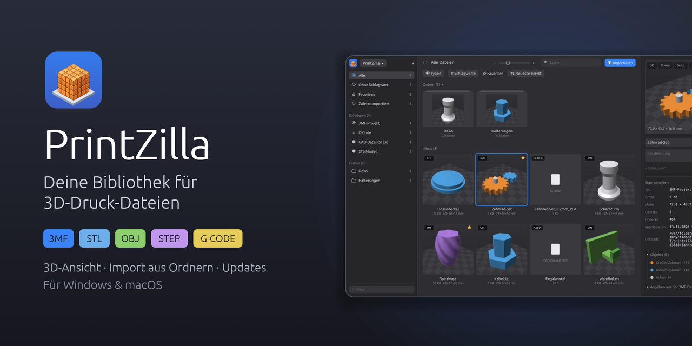
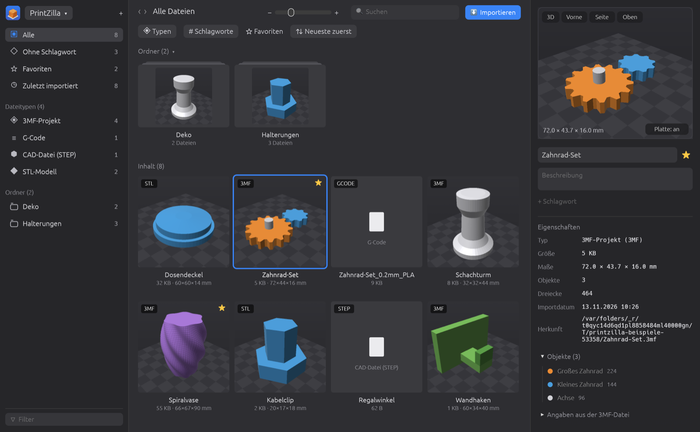

<h1 align="left"> PrintZilla</h1>



**Eine Bibliothek für deine 3D-Druck-Dateien – für Windows und macOS.**

PrintZilla sammelt 3MF-, STL-, OBJ-, STEP- und G-Code-Dateien aus beliebigen Ordnern
(z. B. dem Download-Ordner) in einer aufgeräumten Bibliothek und zeigt 3MF-, STL- und
OBJ-Modelle direkt in 3D an.



## Was PrintZilla kann

- **Importieren** aus einem frei wählbaren Ordner (auch mit Unterordnern). Du siehst vorher,
  welche Dateien neu sind und welche schon in der Bibliothek liegen.
- **Originale behalten, in den Papierkorb legen oder endgültig löschen** – erst nachdem die
  Kopie sicher in der Bibliothek liegt.
- **3D-Ansicht** für 3MF (auch mehrteilige Projekte aus Slicern), STL und OBJ: drehen,
  verschieben, zoomen, Ansichten von vorne, von der Seite und von oben, Maße in Millimetern.
- **Direkt öffnen:** per Rechtsklick „In SolidCraft öffnen“ oder „Öffnen mit“ Bambu Studio,
  OrcaSlicer, PrusaSlicer, Cura oder einem selbst gewählten Programm.
- **Ordnen und finden:** Ordner, Schlagworte, Favoriten, Beschreibung, Filter nach Dateityp,
  Suche, frei einstellbare Größe der Vorschaubilder.
- **Updates:** PrintZilla sucht beim Start nach einer neuen Version und installiert sie auf
  Wunsch selbst (Menü „PrintZilla ▾“ → „Nach Updates suchen …“).

## So sieht es aus


## Herunterladen

Die fertigen Programme gibt es unter **[Releases](../../releases/latest)**:

| System | Datei |
| --- | --- |
| Windows 10/11 | `PrintZilla-Windows.zip` – entpacken und `PrintZilla.exe` starten |
| macOS (Apple-Chip, M1 und neuer) | `PrintZilla-macOS-AppleSilicon.zip` |
| macOS (Intel) | `PrintZilla-macOS-Intel.zip` |

Die Programme sind nicht bei Microsoft bzw. Apple registriert. Beim ersten Start daher:

- **Windows:** Bei „Der Computer wurde durch Windows geschützt“ auf *Weitere Informationen* →
  *Trotzdem ausführen* klicken.
- **macOS:** `PrintZilla.app` in den Programme-Ordner ziehen, dann mit **Rechtsklick → Öffnen**
  starten und „Öffnen“ bestätigen.

## Wo liegen meine Dateien?

Die Bibliothek liegt standardmäßig im Ordner `Dokumente/3D-Druck-Bibliothek`. Über
„PrintZilla ▾“ → „Anderen Bibliotheksordner wählen …“ lässt sich ein anderer Ordner nutzen.

## Eine neue Version veröffentlichen

1. Änderungen committen.
2. `neue-Version-veroeffentlichen.command` doppelklicken (oder ein Git-Tag wie `v0.2.0` pushen).
3. GitHub baut automatisch die Windows- und Mac-Version und legt sie als Release ab
   (siehe `.github/workflows/release.yml`). Danach bieten alle installierten PrintZilla-Programme
   das Update an.

## Vorschaubild für GitHub

`assets/social-card.png` (1280 × 640) ist das Vorschaubild für Links auf dieses Repository.
Hochladen unter *Settings → General → Social preview → Edit → Upload an image*.
Neu erzeugen mit:

```sh
PRINTZILLA_SOCIAL_CARD=1 cargo run -- --screenshot assets/social-card.png
```

## Selbst bauen

Benötigt wird [Rust](https://rustup.rs).

```sh
cargo run --release      # starten
cargo test               # Tests
```

Gebaut mit [egui/eframe](https://github.com/emilk/egui). Die 3D-Ansicht zeichnet PrintZilla
selbst, ohne Grafikkarten-Abhängigkeiten.
